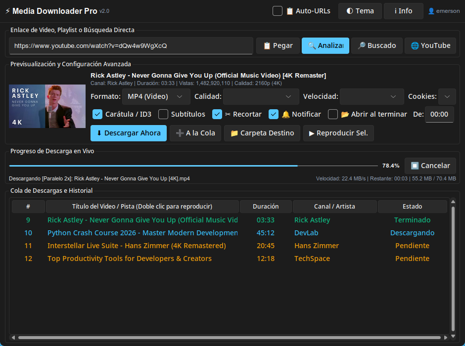

# ⚡ Media Downloader Pro V2.0 (S-Tier Edition)

<p align="center">
  
</p>

<p align="center">
  <strong>Suite multimedia de escritorio definitiva para descargar, convertir, recortar y gestionar videos y pistas de audio de YouTube, Playlists, TikTok, Instagram, Twitter/X y +1000 sitios.</strong>
</p>

<p align="center">
  
  
  
  
  
  
  
</p>

---

## 📸 Capturas de Pantalla

### 🌙 Modo Oscuro (Dark Theme) — Controles Avanzados, Recorte y Descargas en Vivo


### ☀️ Modo Claro (Light Theme) — Diseño Fluent y Alternador de Tema en Caliente


---

## 💎 Características de Nivel Élite (S-Tier)

### 🎬 Descarga en Máxima Resolución y Conversión Real
- **Hasta 4K / 8K y 60 FPS:** Descarga videos individuales, Shorts y playlists completas en resoluciones 4320p, 2160p (4K), 1440p (2K), 1080p, 720p, 480p y 360p.
- **Ensamblado Inteligente (Muxing):** Combina automáticamente los mejores flujos de video y audio independientes con **FFmpeg** sin pérdida de calidad.
- **Audio de Alta Fidelidad:** Conversión real a **MP3 (hasta 320 kbps)**, M4A, WAV y FLAC.
- **Etiquetado ID3 y Carátulas Embebidas:** Inserta título, artista/canal, año y portada original dentro del archivo.

### ✂️ Recorte de Fragmentos de Tiempo (*Trim / Sections*)
- **Descarga solo lo que necesitas:** Define un rango de tiempo específico (*Ej: De `00:30` a `02:15`*) y el motor descargará únicamente ese fragmento con precisión de fotogramas sin necesidad de descargar el video entero.

### 🔍 Buscador de YouTube Integrado (In-App Search)
- **Búsqueda directa sin navegador:** Escribe un término de búsqueda (ej. *"música relajante para programar"*) o pulsa el botón **🔎 Buscador** para explorar los mejores resultados de YouTube con duración y canal, y cargarlos o descargarlos con un solo clic.

### ⚡ Descargas Simultáneas en Paralelo (Multi-Worker Pool)
- **Aprovecha tu conexión al 100%:** Configura la cola para descargar **1, 2, 3 o 4 videos al mismo tiempo** en paralelo utilizando un pool de hilos optimizado.

### 🚦 Limitador de Ancho de Banda y Velocidad
- **Control de tráfico de red:** Evita saturar tu conexión limitando la velocidad de descarga a **10 MB/s, 5 MB/s, 2 MB/s o 1 MB/s** con un solo clic.

### 🍪 Soporte de Cookies del Navegador (*Bypass de +18 y Privados*)
- **Contenido restringido:** Selecciona tu navegador (**Firefox, Chrome, Brave, Edge o Chromium**) para importar cookies de sesión y descargar videos con restricción de edad (+18) o listas de reproducción privadas.

### ▶️ Reproductor Rápido Integrado
- **Escucha o mira al instante:** Botón **"▶ Reproducir Sel."** y soporte para **doble clic** en la lista de descargas para reproducir de inmediato cualquier archivo completado con tu reproductor favorito del sistema.

### 🔔 Notificaciones Nativas y Automatizaciones
- **Avisos de Escritorio:** Notificaciones nativas con sonido en el escritorio del sistema operativo al finalizar descargas individuales o colas masivas.
- **Acciones Post-Descarga:**
  - *Abrir archivo al terminar.*
  - *Suspender o apagar el equipo al finalizar toda la cola* (ideal para descargas nocturnas).

### 🛡️ Tolerancia a Fallos Inteligente (Auto-Recuperación)
- **Superación de Error 429 de YouTube:** Si los subtítulos automáticos son limitados por la API de YouTube (`HTTP Error 429: Too Many Requests`), el motor **no aborta la descarga**; recupera el flujo de video/audio completo y notifica de manera amigable al usuario.

---

## 🛠️ Requisitos Previos

- **Python:** 3.8 o superior.
- **FFmpeg:** Instalado y disponible en el PATH del sistema.
  - **Linux (Arch/Garuda):** `sudo pacman -S ffmpeg`
  - **Linux (Ubuntu/Debian):** `sudo apt install ffmpeg`
  - **Windows:** Descargar de [gyan.dev](https://www.gyan.dev/ffmpeg/builds/) o instalar vía `winget install Gyan.FFmpeg`.
  - **macOS:** `brew install ffmpeg`

---

## 🚀 Instalación y Uso Rápido

1. **Clonar el repositorio:**
   ```bash
   git clone https://github.com/EmersonGt124/Media_Video_Downloader_V1.0.git
   cd Media_Video_Downloader_V1.0
   ```

2. **Instalar dependencias necesarias:**
   ```bash
   pip install pillow sv-ttk
   ```
   *(Nota: `yt-dlp` ya viene preconfigurado y paquetizado dentro de `PROYECTO/lib/yt_dlp_bin` para máxima comodidad).*

3. **Ejecutar la aplicación:**
   ```bash
   cd PROYECTO
   python3 Media_Downloader.py
   ```

---

## 🚀 Descarga Directa (Binarios Portables - Cero Comandos)

Si solo deseas utilizar la aplicación sin necesidad de instalar Python ni abrir una terminal:

👉 **[Descargar la última versión en GitHub Releases](https://github.com/EmersonGt124/Media_Video_Downloader_V1.0/releases/latest)**

| Sistema Operativo | Paquete Descargable | Cómo Usarlo |
| :--- | :--- | :--- |
| 🪟 **Windows 10 / 11** | `MediaDownloaderPro-Windows-x64.zip` | Descomprimir y hacer doble clic en `MediaDownloaderPro.exe` *(incluye FFmpeg integrado)*. |
| 🐧 **Linux (Ubuntu, Arch, Fedora)** | `MediaDownloaderPro-Linux-x64.tar.gz` | Descomprimir y ejecutar `./MediaDownloaderPro`. |
| 🍎 **macOS (Intel / Apple Silicon)** | `MediaDownloaderPro-macOS-x64.zip` | Descomprimir y hacer doble clic para abrir la app. |

---

## 💻 Ejecución desde el Código Fuente (Desarrolladores)

Si deseas clonar y ejecutar el proyecto con Python:

```bash
# 1. Clona el repositorio
git clone https://github.com/EmersonGt124/Media_Video_Downloader_V1.0.git
cd Media_Video_Downloader_V1.0

# 2. Instala las dependencias
pip install -r requirements.txt

# 3. Inicia la aplicación
cd PROYECTO
python3 Media_Downloader.py
```

---

## 📂 Estructura del Proyecto

```text
Media_Video_Downloader_V1.0/
├── assets/                     # Capturas de pantalla e imágenes para documentación
│   ├── preview_dark.png
│   └── preview_light.png
├── PROYECTO/                   # Código fuente de la aplicación
│   ├── Media_Downloader.py     # Punto de entrada principal
│   ├── Downloader_Engine.py    # Motor yt-dlp + FFmpeg con recorte, velocidad, cookies y buscador
│   ├── Database.py             # Capa de persistencia con SQLite y tracking de rutas
│   ├── Youtube_Funciones.py    # Vista principal, buscador modal y herramientas élite
│   ├── Home_Funciones.py       # Ventana principal, barra superior y gestión de temas
│   ├── Botones_Funciones.py    # Controladores multihilo, descargas paralelas y notificaciones
│   ├── Alertas.py              # Diálogos y alertas multiplataforma limpias
│   ├── Screen_Holding.py       # Splash screen nativo
│   ├── Variables.py            # Rutas, colores y estados globales
│   ├── NOTAS                   # Bitácora interna de desarrollo
│   └── lib/
│       ├── yt_dlp_bin          # Binario paquetizado de yt-dlp
│       └── data/               # Base de datos SQLite, fuentes e iconos
├── LICENSE                     # Licencia Mozilla Public License 2.0
└── README.md                   # Documentación principal del repositorio
```

---

## 🤝 Plataformas Compatibles

Gracias al motor avanzado `yt-dlp`, Media Downloader Pro es capaz de procesar enlaces de:
- **YouTube** (Videos 4K/8K, Shorts, Playlists, Canales, Transmisiones finalizadas).
- **TikTok** (Sin marcas de agua cuando la plataforma lo permite).
- **Instagram** (Reels, Posts y Videos).
- **Twitter / X** (Clips y publicaciones de video).
- **Facebook** (Reels y videos públicos).
- **SoundCloud**, **Twitch Clips**, **Vimeo**, **Dailymotion** y más de 1.000 sitios soportados.

---

## 📄 Licencia

Este proyecto está bajo la licencia **Mozilla Public License Version 2.0 (MPL 2.0)**. Consulta el archivo [LICENSE](LICENSE) para más información.
