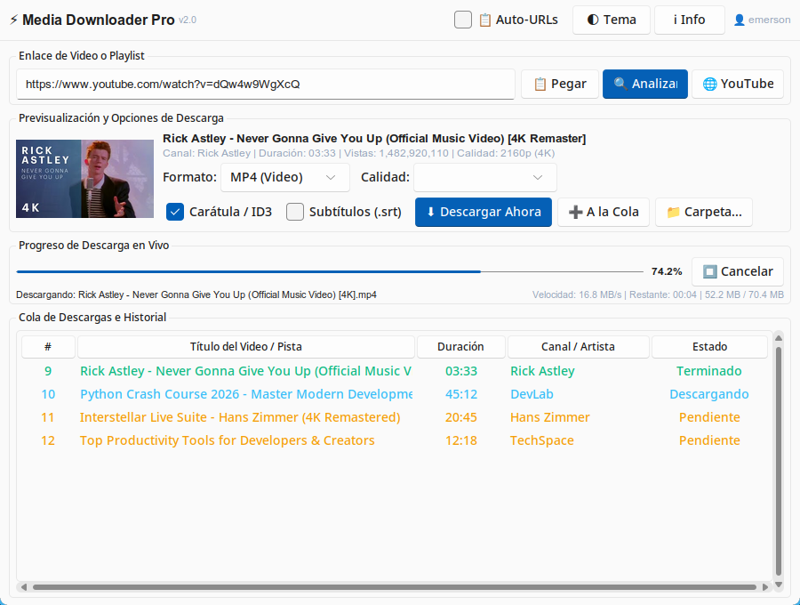

# ⚡ Media Downloader Pro V2.0

<p align="center">
  
</p>

<p align="center">
  <strong>Aplicación de escritorio moderna, rápida y multiplataforma para descargar videos y audios de YouTube, Playlists, TikTok, Instagram, Twitter/X y +1000 sitios.</strong>
</p>

<p align="center">
  
  
  
  
  
  
  
</p>

---

## 📸 Capturas de Pantalla

### 🌙 Modo Oscuro (Dark Theme) — Previsualización y Descarga en Vivo


### ☀️ Modo Claro (Light Theme) — Alternador de Tema en Caliente


---

## ✨ Características Principales

### 🎬 Video de Máxima Calidad
- **Hasta 4K / 8K y 60 FPS:** Descarga videos individuales, Shorts y listas completas en resoluciones 4320p, 2160p (4K), 1440p (2K), 1080p, 720p, 480p y 360p.
- **Ensamblado Inteligente (Muxing):** Combina automáticamente los mejores flujos de video y audio independientes con **FFmpeg** sin pérdida de fidelidad.

### 🎵 Extracción de Audio Real y Metadatos ID3
- **Formatos Profesionales:** Conversión real a **MP3 (hasta 320 kbps)**, M4A, WAV y FLAC (se eliminó la práctica de renombrar extensiones).
- **Etiquetado ID3 Completo:** Guarda metadatos de título, artista/canal, año y álbum directamente en el archivo de audio.
- **Incrustación de Carátula:** Inserta la portada original del video en alta resolución dentro de los archivos MP3 y MP4.

### 🛡️ Tolerancia a Fallos Inteligente (Auto-Recuperación)
- **Superación de Error 429 de YouTube:** Si los subtítulos automáticos son limitados por la API de YouTube (`HTTP Error 429: Too Many Requests`), el motor **no aborta la descarga**; recupera el flujo de video/audio completo y notifica de manera amigable al usuario.
- **Protección de Carátula:** Si un archivo multimedia exótico rechaza la carátula embebida, la descarga continúa sin errores y se genera el archivo funcionalmente intacto.

### ⚡ Arquitectura Asíncrona (Cero Congelamientos)
- **Multihilo (`threading`):** El análisis de enlaces, descarga de miniaturas y transferencias de archivos se ejecutan en hilos secundarios dedicados. La interfaz responde fluidamente en todo momento.
- **Progreso y Métricas en Tiempo Real:** Barra de progreso porcentual, medidor de velocidad en tiempo real (`MB/s`), tiempo estimado restante (`ETA`) y bytes transferidos.
- **Botón de Cancelación Inmediata:** Detén cualquier descarga en ejecución de manera segura y limpia con un solo clic.

### 📋 Cola de Descargas y Playlists con SQLite
- **Persistencia Rápida y Segura:** Base de datos local SQLite (`lib/data/downloads.db`) en reemplazo de pesados archivos de cálculo.
- **Gestión por Lotes:** Descarga videos individuales o vacía la cola completa de forma desatendida.

### 🖥️ Interfaz Moderna y Responsiva
- **Tema Sun Valley (`sv_ttk`):** Estilo Fluent / Windows 11 moderno con esquinas suaves y paleta Dark/Light intercambiable.
- **Auto-detección de Portapapeles:** Detecta automáticamente enlaces multimedia copiados desde el navegador para pegarlos y analizarlos al instante.
- **Diseño Adaptable:** Los controles se reorganizan dinámicamente según el tamaño de la ventana, sin cortar botones ni requerir resoluciones gigantescas.

---

## 🛠️ Requisitos Previos

- **Python:** 3.8 o superior.
- **FFmpeg:** Instalado y disponible en el PATH del sistema.
  - **Linux (Arch/Garuda):** `sudo pacman -S ffmpeg`
  - **Linux (Ubuntu/Debian):** `sudo apt install ffmpeg`
  - **Windows:** Descargar de [gyan.dev](https://www.gyan.dev/ffmpeg/builds/) y agregar al PATH o instalar vía `winget install Gyan.FFmpeg`.
  - **macOS:** `brew install ffmpeg`

---

## 🚀 Instalación y Uso

1. **Clonar el repositorio:**
   ```bash
   git clone https://github.com/emerson199818/Media_Video_Downloader_V1.0.git
   cd Media_Video_Downloader_V1.0
   ```

2. **Instalar dependencias necesarias:**
   ```bash
   pip install pillow sv-ttk
   ```
   *(Nota: `yt-dlp` ya viene preconfigurado y paquetizado dentro de `PROYECTO/lib/yt_dlp_bin` para máxima comodidad).*

3. **Ejecutar la aplicación:**
   ```bash
   cd PROYECTO
   python3 Media_Downloader.py
   ```

---

## 📂 Estructura del Proyecto

```text
Media_Video_Downloader_V1.0/
├── assets/                     # Capturas de pantalla e imágenes para documentación
│   ├── preview_dark.png
│   └── preview_light.png
├── PROYECTO/                   # Código fuente de la aplicación
│   ├── Media_Downloader.py     # Punto de entrada principal
│   ├── Downloader_Engine.py    # Motor yt-dlp + FFmpeg con auto-fallback
│   ├── Database.py             # Capa de persistencia con SQLite
│   ├── Youtube_Funciones.py    # Vista principal y controles de usuario
│   ├── Home_Funciones.py       # Ventana principal, barra superior y temas
│   ├── Botones_Funciones.py    # Controladores de hilos, Treeview y descargas
│   ├── Alertas.py              # Diálogos y alertas multiplataforma
│   ├── Screen_Holding.py       # Splash screen nativo
│   ├── Variables.py            # Rutas, colores y estados globales
│   ├── NOTAS                   # Bitácora interna de desarrollo
│   └── lib/
│       ├── yt_dlp_bin          # Binario paquetizado de yt-dlp
│       └── data/               # Base de datos SQLite, fuentes e iconos
├── LICENSE                     # Licencia Mozilla Public License 2.0
└── README.md                   # Documentación principal del repositorio
```

---

## 🤝 Plataformas Compatibles

Gracias a la integración con `yt-dlp`, Media Downloader Pro es capaz de procesar enlaces de:
- **YouTube** (Videos regulares, Shorts, Playlists, Canales, Transmisiones finalizadas).
- **TikTok** (Sin marcas de agua cuando la plataforma lo permite).
- **Instagram** (Reels, Posts y Videos).
- **Twitter / X** (Clips y publicaciones de video).
- **Facebook** (Reels y videos públicos).
- **SoundCloud**, **Twitch Clips**, **Vimeo**, **Dailymotion** y más de 1.000 sitios soportados.

---

## 📄 Licencia

Este proyecto está bajo la licencia **Mozilla Public License Version 2.0 (MPL 2.0)**. Consulta el archivo [LICENSE](LICENSE) para más información.
